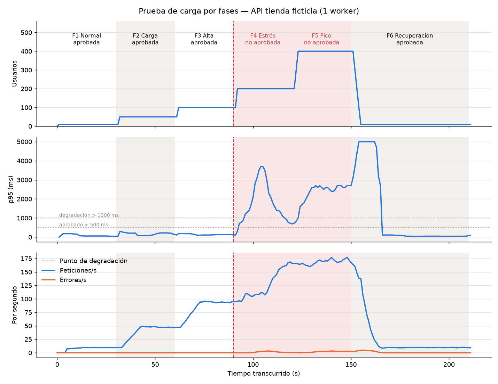

# 03 · Análisis de resultados

Corrida oficial del **10 de octubre de 2026**, con 210 s de carga en 6 fases y
`ITERACIONES_REPORTE = 400_000`. Hubo **14.386 peticiones** en total, de las cuales
**143 fallaron (0,99 %)**. Todos los números salen de los archivos de `resultados\`.

## 1. Resultados por fase

| Fase | Usuarios | Peticiones/s | p50 (ms) | p95 (ms) | % errores | Estado |
|---|---|---|---|---|---|---|
| F1 Normal | 10 | 9,7 | 22 | 60 | 0,00 | ✅ APROBADA |
| F2 Carga | 50 | 47,9 | 24 | 155 | 0,00 | ✅ APROBADA |
| F3 Alta | 100 | 94,8 | 34 | 125 | 0,00 | ✅ APROBADA |
| F4 Estrés | 200 | 156,6 | 170 | **2100** | 0,74 | ❌ NO APROBADA |
| F5 Pico | 400 | 168,7 | 1200 | **2600** | 1,75 | ❌ NO APROBADA |
| F6 Recuperación | 10 | 9,8 | 8 | 50 | 0,00 | ✅ APROBADA |

*Cada fase se mide sin sus primeros 10 s de transición; p50/p95 = mediana de los valores por segundo (ver estrategia, sección 10).*

| Criterio | Resultado |
|---|---|
| Punto de degradación | **F4 Estrés** (p95 2100 ms > 1000 ms) |
| Recuperación OK | **Sí**: p95 F6 = 50 ms ≤ 72 ms (1,2 × 60 ms) y 0 % de errores |
| Tiempo hasta recuperar | 28 s desde el inicio de F6 (incluye la ventana de 10 s de Locust) |
| CP-02 Validación | **Sí**: 1448 de 1448 inválidas respondieron 422, ninguna 500 |
| CP-04 Fallas técnicas | 143 timeouts (> 5 s), 0 errores 5xx; la API siguió respondiendo |

### p95 por endpoint y fase (ms)

| Endpoint | F1 | F2 | F3 | F4 | F5 | F6 |
|---|---|---|---|---|---|---|
| `GET /api/productos` (lectura simple) | 49 | 74 | 115 | 650 | 1500 | 32 |
| `POST /api/pedidos` (escritura) | 63 | 465 | 140 | **4600** | **5000** | 59 |
| `POST /api/pedidos [inválido]` | 29 | 52 | 39 | 320 | 1200 | 6 |
| `GET /api/reporte` (cuello de botella) | 67 | 120 | 140 | 690 | 1600 | 50 |
| **Todas (Aggregated)** | 60 | 155 | 125 | 2100 | 2600 | 50 |

*Fuente: filas por endpoint de `resultados\run_stats_history.csv`, mismo método que la tabla anterior.*

## 2. Interpretación fase por fase

- **F1 Normal (10 usuarios).** Es la línea base. Casi todas las peticiones tardan
  menos de 25 ms (p50 22 ms) y el p95 de 60 ms corresponde a los reportes, que
  son la operación más lenta.
- **F2 Carga (50 usuarios).** El rendimiento crece en proporción a los usuarios
  (≈ 48 pet/s) y la fase aprueba con holgura. Hubo un pico aislado en los pedidos
  (p95 465 ms) que no se repitió en F3. Puede deberse al guardado periódico del
  WAL de SQLite (*checkpoint*) o a ruido del equipo; no cambia el veredicto.
- **F3 Alta (100 usuarios).** Todavía escala (≈ 95 pet/s) y aprueba con un p95 de
  125 ms. Es la **última fase aprobada**.
- **F4 Estrés (200 usuarios).** El rendimiento ya no crece al ritmo de los
  usuarios: con el doble de usuarios solo sube a ≈ 157 pet/s. La API llegó a su
  capacidad y las peticiones empiezan a hacer fila. El p95 salta a 2100 ms, por
  lo que **F4 es el punto de degradación**. Aparecen los primeros timeouts.
- **F5 Pico (400 usuarios).** Duplicar otra vez los usuarios casi no aumenta el
  rendimiento (≈ 169 pet/s): la capacidad está agotada y cada usuario extra solo
  agrega espera. Según la ley de Little, 400 usuarios ≈ 169 pet/s × (1 s de pausa
  + ~1,4 s de espera media por respuesta). El p95 por segundo llega a 5000 ms, el
  timeout, y aquí ocurre la mitad de las fallas (73 de 143; F4 tuvo 38 y el
  arranque de F6, 32).
- **F6 Recuperación (10 usuarios).** En los primeros segundos todavía terminan o
  vencen peticiones enviadas en F5 (32 timeouts en los primeros 5 s). Luego el p95
  vuelve a ~41–50 ms, igual o mejor que F1, **sin reiniciar la API**.

## 3. Hallazgos

1. **Capacidad máxima de ≈ 160–170 peticiones/s con 1 worker.** A partir de F4,
   agregar usuarios no aumenta el rendimiento, solo la espera. La API cumple el
   criterio hasta 100 usuarios (F3) y se degrada a los 200 (F4).
2. **El cuello de botella es compartido.** El reporte pesado ocupa la CPU del único
   proceso, y por el GIL de Python frena a **todos** los endpoints. Listar
   productos, que es una lectura trivial de 20 filas, pasó de 49 ms (F1) a 650 ms
   (F4) y 1500 ms (F5): unas 30 veces más lento.
3. **Las escrituras son el eslabón más frágil.** `POST /api/pedidos` llegó a 4600 ms
   en F4 y al tope de 5000 ms en F5, y concentra **el 100 % de los 143 timeouts**.
   SQLite acepta un solo escritor a la vez: cuando la CPU está saturada, el pedido
   que tiene el turno de escritura tarda más en terminar y los demás esperan detrás.
4. **La validación funcional resiste la carga.** Las 1448 peticiones inválidas
   respondieron 422 y ninguna 500. Son de las más rápidas (p50 de 9 ms en toda la
   prueba) porque FastAPI rechaza los datos mal formados antes de tocar la base de datos.
5. **La falla es por lentitud, no por errores internos.** No hubo ningún 5xx: la API
   no lanza excepciones ni se cae, simplemente responde tarde. Para el usuario, un
   timeout de 5 s es igual de grave. En F5 los errores fueron del 1,75 %, por debajo
   del 5 %, así que la degradación se detecta por **latencia**.
6. **Hay recuperación, pero no es instantánea.** Durante ~16 s después del pico el
   p95 por segundo siguió por encima de 2700 ms; hasta 10 s de eso se deben a la
   ventana móvil de Locust. El servidor aún procesaba peticiones que los clientes
   ya habían abandonado por timeout, lo que es trabajo desperdiciado. Luego quedó
   unos segundos en ~100 ms y a los 28 s volvió al nivel base (≤ 72 ms).
7. **Hay pedidos guardados sin confirmación.** Al terminar, la base tenía **4354
   pedidos**, pero Locust solo recibió confirmación (201) de **4159** (4302
   enviados menos 143 timeouts). Hay **195 pedidos que se guardaron sin que el
   cliente lo supiera**: 143 cuyo cliente se rindió a los 5 s, aunque el servidor
   terminó el trabajo, y 52 de usuarios detenidos a mitad de petición al bajar la
   carga. En un sistema real, si el cliente reintenta, el pedido queda
   **duplicado**. Esta inconsistencia es un riesgo funcional causado por el estrés.
8. **El resultado depende del ambiente.** En la calibración, la misma
   configuración dio un p95 de 835 ms en F4 en una corrida y de 2100 ms en la
   oficial. El punto de degradación está en la frontera F4/F5, y un equipo ocupado
   (antivirus, otros programas, CPU que baja su frecuencia) lo adelanta. Ver la
   tabla de calibración en la estrategia.
9. **En otra corrida apareció un tercer tipo de falla: conexiones rechazadas.**
   Repetimos la prueba con la misma configuración desde CMD, para validar los
   comandos de Windows. Volvió a degradarse en F4 (p95 2100 ms) y a recuperarse
   (F6: 71 ms ≤ 79 ms), pero vino más cargada: F3 no aprobó (620 ms) y F5 llegó a
   7,69 % de errores. Además de 346 timeouts, hubo **23 conexiones rechazadas**
   (`WinError 10061`) en pleno pico: con la CPU saturada, el servidor no alcanzó a
   aceptar las conexiones nuevas. También se repitió el hallazgo 7: 3580 pedidos
   en la base frente a 3356 confirmados. Esa evidencia no reemplaza a la oficial;
   se resume en la tabla de calibración de la estrategia (corrida 9).

## 4. Conclusiones

- Con 1 worker, la API **soporta hasta ~100 usuarios simultáneos** (F3) dentro del
  criterio de calidad. **Se degrada con 200 usuarios (F4)**, cuando alcanza su
  capacidad de ~160–170 peticiones/s.
- La degradación es **controlada**: no hay caída, no hay errores 5xx, la
  validación sigue funcionando y el sistema **se recupera solo** al retirar la
  carga. Los 5 casos de prueba resultaron **aprobados**.
- El cuello de botella es la CPU consumida por `/api/reporte`, que afecta a todos
  los endpoints. Las escrituras en SQLite son las primeras en fallar por timeout,
  y un timeout no significa que el pedido no se guardó: 195 pedidos quedaron sin
  confirmación.
- El laboratorio muestra el método completo de una prueba de rendimiento:
  definir criterios, subir la carga por escalones, encontrar el punto de
  degradación, provocar fallas y verificar la recuperación, todo con evidencia
  reproducible.

## 5. Posibles mejoras

Cada mejora se verifica repitiendo la misma corrida y comparando `resumen.md`. Si
la mejora funciona, el punto de degradación debería pasar a una fase posterior y
el p95 de F4/F5 debería bajar.

| Mejora | Qué cambia | Efecto esperado | Ojo con |
|---|---|---|---|
| **Más workers** (`uvicorn ... --workers 4`) | Varios procesos, cada uno con su propio GIL, que usan varios núcleos | Capacidad cercana a ×N, hasta el límite de núcleos o de escrituras | SQLite sigue aceptando un escritor a la vez, y Locust compite por CPU en la misma máquina |
| **Caché** | Guardar el resultado de `/api/reporte` unos segundos (los totales no necesitan ser al instante) y el catálogo de `/api/productos` | Elimina casi todo el costo de CPU del reporte, el cuello de botella | Datos levemente desactualizados; definir el tiempo de vida de la caché |
| **Índices** | Hoy las consultas usan la clave primaria (ya indexada) y un total sobre toda la tabla, que un índice no acelera. Si el reporte filtrara por producto o fecha: `CREATE INDEX idx_pedidos_producto ON pedidos(producto_id)` | Consultas de reporte más rápidas a medida que crecen los pedidos | Cada índice hace un poco más lenta cada escritura. Alternativa: llevar los totales en una tabla resumen |
| **Límites de tasa y concurrencia** | Limitar `/api/reporte` por cliente (responder 429) o usar `uvicorn --limit-concurrency N` (responde 503 de inmediato al pasar el límite) | Falla rápida en lugar de hacer esperar a todos; evita trabajo desperdiciado y protege los endpoints simples | Algunos usuarios reciben un rechazo, que es preferible a un timeout de 5 s para todos |
| **Clave de idempotencia en pedidos** | El cliente envía un identificador único por pedido y la API ignora los repetidos | Un reintento tras un timeout no duplica el pedido (hallazgo 7) | Guardar y consultar la clave en cada pedido |
| Otras | Generar el reporte en segundo plano o precalculado; usar PostgreSQL para muchas escrituras concurrentes; correr Locust en otra máquina | Separar el trabajo pesado del camino de la petición y medir sin interferencia | Más componentes que operar |
